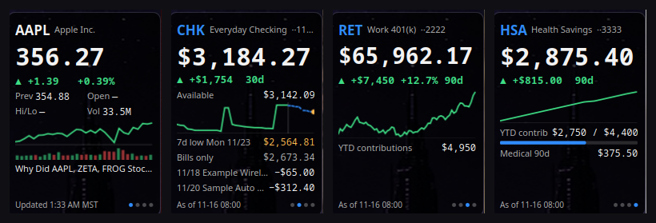

# Plasma Stock Ticker + HUD Card

Two small KDE Plasma 5 desktop widgets (plasmoids) for keeping an eye on markets and on your own money without opening a browser:

- **Stock Ticker**: a scrolling quote strip for a panel or the desktop.
- **HUD Card**: a square heads-up card that cycles through pages. Each page is either a **stock** (price, change, day stats, 30-day trend, volume bars, latest headline) or one of **your accounts** (checking/savings, 401(k)/IRA, HSA), each with its own layout.



*The screenshot uses made-up demo data from [`examples/accounts.example.json`](examples/accounts.example.json).*

## Features

**HUD Card**
- Cycles pages on a timer (default 10 s), **pauses while you hover**, and advances when you **click or scroll**. The page dots show where you are, and you can click one to jump to it.
- **Stock page:** last price, change, previous close, open, high/low and volume. It also draws a 30-day close trend line and volume bars colored by up or down day, and shows the latest Google News headline (click it to open).
- **Checking / savings page:**
  - Current balance and available balance, with the 30-day change.
  - A 30-day balance trend line, plus a **7-day forecast** drawn as a dashed electric-blue line.
  - The **lowest projected balance** and its date. It turns red below zero.
  - A "bills only" low for comparison, and the next upcoming recurring items.
- **Retirement page (401(k), IRA, brokerage):** balance, change over the period ($ and %), trend line, YTD contributions, and optional extra stats (for example, loan repayments).
- **HSA page:** balance, a trend line, YTD contributions against the annual limit (with a progress bar), and medical spending over the last 90 days.
- **No credentials, ever.** The card only *reads* a local JSON file that you produce. It never talks to your bank.

**Stock Ticker**
- Shows any number of symbols, plus `^VIX`, `BTC-USD`, `ETH-USD` and the major indexes.
- Smooth scrolling, with green and red change coloring.

## Install

Requires KDE Plasma 5.27 (Qt 5.15), `python3` and `curl`.

```bash
git clone https://github.com/zerohaste/plasma-stock-ticker.git
cd plasma-stock-ticker
kpackagetool5 -t Plasma/Applet -i plasmoids/hudcard
kpackagetool5 -t Plasma/Applet -i plasmoids/stockticker
```

Then right-click the desktop or a panel, choose **Add Widgets…**, and search for **HUD Card** or **Stock Ticker**.

To upgrade later, use `kpackagetool5 -t Plasma/Applet -u plasmoids/hudcard` (and the same for `stockticker`). If Plasma keeps showing the old version, restart the shell with `systemctl --user restart plasma-plasmashell.service`.

To remove them: `kpackagetool5 -t Plasma/Applet -r com.controllimit.stockcard` and `kpackagetool5 -t Plasma/Applet -r com.controllimit.stockticker`.

## Configure

### HUD Card
Right-click the card and choose **Configure HUD Card…**

| Setting | What it does | Default |
|---|---|---|
| Pages | One page per line, in order. Each line is `AAPL` (a stock), `TSLA \| Tesla stock` (a stock with its own news search), or `@checking-1111` (an account `id` from your accounts file). Lines starting with `#` are ignored. | `AAPL`, `MSFT`, `NVDA` |
| Seconds per page | How long each page shows. `0` turns cycling off. | 10 |
| Pause while hovering | Stops cycling while the pointer is over the card. | on |
| Accounts file | The path of your accounts JSON file. | `~/.local/share/controllimit-hud/accounts.json` |
| Refresh (market / after hours) | How often quotes are re-fetched. | 60 s / 300 s |

Example page list:

```
AAPL
NVDA | Nvidia stock
@demo-checking
@demo-401k
@demo-hsa
```

To try the account pages right away, point **Accounts file** at `examples/accounts.example.json` in this repo.

### Stock Ticker
List the symbols separated by commas or spaces (default `AAPL, MSFT, NVDA, AMZN, GOOGL, SPY, QQQ, BTC-USD`) and set a refresh interval.

## Account data

The card reads a single JSON file. Keep it private:

```bash
mkdir -p ~/.local/share/controllimit-hud
chmod 700 ~/.local/share/controllimit-hud
# ...write accounts.json there, then:
chmod 600 ~/.local/share/controllimit-hud/accounts.json
```

You can write that file yourself, but the easy way is to let [`tools/hud-accounts-build.py`](tools/hud-accounts-build.py) build it from a simpler input. The tool computes the history, the forecast and the summaries for you:

```bash
python3 tools/hud-accounts-build.py my-input.json \
    [--transactions-csv my-transactions.csv] \
    -o ~/.local/share/controllimit-hud/accounts.json
```

- **Input:** see [`examples/accounts.input.example.json`](examples/accounts.input.example.json). It lists the balances, plus transactions for cash accounts and optional history and contributions for investment accounts.
- **CSV:** see [`examples/transactions.example.csv`](examples/transactions.example.csv). The columns are `account_id,date,amount,description[,pending]`. A positive amount is money in and a negative amount is money out.
- **History builds over time:** each run keeps the previous daily balances from the output file. If you run it once a day, accounts you only know the current balance for gradually get a real trend line.

### Data schema (`accounts.json`)

```jsonc
{
  "version": 1,
  "generated": "2026-11-16T08:00-07:00",   // shown as "As of …" on account pages
  "accounts": [
    {
      "id": "demo-checking",               // used in the Pages list as @demo-checking
      "type": "checking",                  // checking | savings | retirement | hsa
      "name": "Everyday Checking",         // a short nickname
      "mask": "1111",                      // last 4 digits only; never store full numbers
      "institution": "Example Bank",       // optional
      "balance": 3184.27,
      "available": 3142.09,                // optional (cash accounts)
      "currency": "USD",

      // cash accounts
      "history":  [{"d": "2026-10-17", "v": 1430.12}, ...],  // daily, 30 days
      "change":   {"amount": 1754.15, "days": 30},
      "forecast": [{"d": "2026-11-16", "v": 3142.09}, ...],  // today + 7 days
      "forecastLow": {"d": "2026-11-23", "v": 2564.81},
      "forecastLowBillsOnly": 2673.34,
      "discretionaryPerDay": 15.5,
      "upcoming": [{"d": "2026-11-18", "label": "Example Wireless", "amount": -65.0}],

      // retirement / hsa
      "history": [{"d": "2026-08-18", "v": 58500.0}, ...],
      "change": {"amount": 7450.02, "pct": 12.73, "days": 90},
      "ytdContributions": 4950.0,          // null shows as "—"
      "estimated": false,                  // true adds "Trend estimated…" note
      "contributionLimit": 4400,           // hsa
      "medicalSpend": {"days": 90, "amount": 375.5},   // hsa
      "extra": [{"label": "Loan repaid YTD", "value": 1200}]  // up to 3 extra rows
    }
  ]
}
```

Only `id`, `type`, `name` and `balance` are required. Anything missing is simply not drawn.

### How the 7-day forecast works
1. **History.** The 30-day balance line is rebuilt backwards from today's balance by undoing each posted transaction.
2. **Recurring items.** Transactions are grouped by a cleaned-up merchant name and by similar amount (within about 25%). A group counts as recurring when it:
   - appears in at least three different months (two if you supplied less than about 80 days of data),
   - repeats on a weekly, biweekly or monthly rhythm, and
   - keeps a steady amount (median absolute deviation ≤ 25% of the median).

   The next date comes from the usual day of the month or the usual interval. If an item is up to five days late, it's expected tomorrow, unless a similar-sized charge already posted. Items that have stopped are dropped.
3. **Everyday spending.** The forecast also subtracts your average daily non-recurring spending over the last 30 days. Single purchases over $500 are ignored as one-offs. Pass `--no-discretionary` to forecast from recurring items only. The card shows both lows: the forecast low and the "bills only" low.
4. **Starting point.** The forecast starts from today's balance plus any pending transactions.

It's a heads-up, not financial advice. Irregular income, transfers and annual bills won't be predicted.

## Data sources and limits

| Data | Source | Notes |
|---|---|---|
| Quotes | CNBC `restQuote` web service | Unofficial and undocumented, and it needs a browser User-Agent. Quotes may be delayed and the service can change without notice. |
| Daily history and volume | Nasdaq `api.nasdaq.com` historical endpoint | Unofficial. Cached for 30 minutes under `~/.cache/controllimit-hud`. |
| Headlines | Google News RSS search | Cached for 15 minutes. |
| Accounts | Your local JSON file | Nothing is sent anywhere. |

Yahoo Finance's public endpoints often rate-limit desktop clients (HTTP 429), so they aren't used. These are free, unofficial sources, so be gentle with refresh intervals and don't build anything critical on them.

## Privacy

- The widgets store no credentials and never contact a financial institution.
- Show accounts by nickname and last four digits only. The builder keeps only the last four characters of `mask`, and it removes number-like tokens from transaction labels.
- `accounts.json` is listed in `.gitignore`, so you don't commit your real data by accident.

## License

MIT. See [LICENSE](LICENSE).

---

Built by [controllimit.com](https://controllimit.com).
